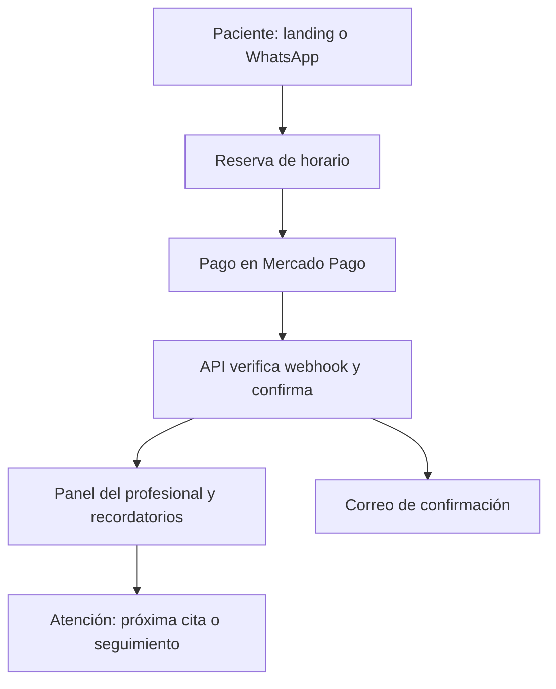

# Arquitectura preliminar del software odontológico

**Versión:** 0.1 · **Estado:** propuesta inicial, pendiente de validar con el SRS del cliente  
**Objetivo:** definir una base técnica y funcional para comenzar diseño y prototipo sin fijar reglas de negocio aún no confirmadas.

**Actualización de trabajo:** [docs/SRS.md](docs/SRS.md) propone respuestas provisionales para avanzar con prototipo y datos sintéticos sin esperar el cuestionario. Sus hipótesis detallan esta propuesta sin constituir aprobación del cliente ni habilitar cobros o pacientes reales. No cambia el stack ni el límite del MVP administrativo.

## 1. Decisión de arquitectura

Construir una aplicación web responsive instalable como PWA, dentro de un **monolito modular** y un monorepo. La primera versión cubrirá la captación del paciente, agenda, reserva con pago y seguimiento administrativo.

No recomiendo partir con microservicios ni una app móvil nativa. El sistema aún tiene un solo profesional piloto y varias reglas por descubrir. El monolito modular permitirá cambiar el flujo rápido sin sumar operación distribuida.

### Stack propuesto

- **Panel y páginas públicas:** Next.js + React + TypeScript.
- **API:** NestJS + TypeScript, organizada por módulos de negocio.
- **Base de datos:** PostgreSQL administrado, con TypeORM y migraciones versionadas.
- **Monorepo:** pnpm Workspaces; empezar sin Turborepo y añadirlo sólo si el equipo o el tiempo de build lo justifican.
- **Runtime:** Node.js 24 LTS. Pin de Node y pnpm en los archivos del proyecto; no usar “latest” sin versión fijada.
- **Pagos:** Mercado Pago Checkout Pro; el backend crea la preferencia y confirma el resultado con notificaciones verificadas.
- **Mensajería inicial:** correo transaccional y enlace manual a WhatsApp. Automatizar WhatsApp después de validar el canal y sus reglas.
- **Despliegue:** una plataforma administrada para frontend/API, base de datos administrada, HTTPS, respaldos y manejo de secretos.

### Decisiones que podemos fijar desde ya

- Un solo repositorio Git con `apps/web`, `apps/api` y paquetes compartidos. pnpm soporta workspaces para monorepos; por ahora no necesitamos una herramienta de orquestación adicional.
- El frontend y la API tendrán despliegues separados, aunque vivan en el mismo repositorio.
- La API será REST con `/api/v1`; contratos y validaciones se documentan con OpenAPI.
- PostgreSQL será la fuente de verdad. TypeORM permitirá trabajar con entidades y repositorios dentro de NestJS, con migraciones revisadas y versionadas; no se actualizará el esquema automáticamente al iniciar producción.
- Desarrollo local reproducible con Docker Compose para PostgreSQL, archivos `.env.example` sin secretos y migraciones desde el primer cambio de esquema.
- CI mínimo en GitHub Actions: instalar con lockfile, lint, typecheck, pruebas y build. Ramas `main` protegidas; el SRS se convierte en historias antes de desarrollar flujos reales.
- Nada de Redis, colas, microservicios ni aplicación móvil nativa en la primera base. Se agregan cuando exista una necesidad medida.

## 2. Mapa del sistema



La vuelta desde Mercado Pago al navegador sólo muestra el resultado de retorno. La cita se confirma cuando el servidor recibe y verifica el evento de pago, para no depender de que el usuario vuelva a la página.

## 3. Módulos funcionales

| Módulo | Responsabilidad inicial |
|---|---|
| Sitio público | Landing, información del servicio, preguntas frecuentes, CTA de reserva y CTA de WhatsApp. |
| Identidad y acceso | Inicio de sesión, usuarios del consultorio y permisos. |
| Configuración del consultorio | Perfil profesional, horarios, duración de citas y políticas visibles. |
| Agenda | Disponibilidad semanal, excepciones, bloqueos, ubicaciones/box y citas. |
| Reservas | Solicitud, bloqueo temporal del horario, expiración y estados de la cita. |
| Pagos | Preferencia de checkout, evento de webhook, confirmación, conciliación y devolución manual según reglas aprobadas. |
| Contactos y seguimiento | Datos mínimos de contacto, etapa, próxima acción e historial administrativo. |
| Notificaciones | Email de solicitud, pago, confirmación, recordatorio y cambios. |
| Reportes básicos | Reservas, pagos registrados, asistencia/inasistencia y horas recuperadas. |
| Auditoría | Registro de quién cambió horarios, citas, pagos y textos de política. |

**Fuera del MVP hasta confirmación:** ficha clínica, odontograma, recetas, diagnósticos, fotografías clínicas, radiografías, firma de consentimientos clínicos y facturación clínica. Son una fase de producto separada, con mayor alcance de privacidad y operación.

## 4. Estructura del repositorio

Propuesta de monorepo para que la web, API y tipos compartidos evolucionen juntos:

```text
odontologia-platform/
├── apps/
│   ├── web/                 # Next.js: landing pública, reserva y panel PWA
│   ├── api/                 # NestJS: API REST y módulos de negocio
│   └── worker/              # Futuro: recordatorios programados y tareas en cola
├── packages/
│   ├── ui/                  # Componentes reutilizables
│   ├── contracts/           # DTOs, tipos y esquemas de validación compartidos
│   ├── config/              # Configuración común de lint, TypeScript y formato
│   └── api-client/           # Cliente tipado para consumir la API
├── infra/
│   ├── docker-compose.yml   # Desarrollo local: PostgreSQL y herramientas necesarias
│   └── deploy/               # Configuración del proveedor de despliegue
├── docs/
│   ├── SRS.md                # Requisitos aprobados por el cliente
│   ├── architecture.md       # Arquitectura y decisiones técnicas
│   ├── data-dictionary.md    # Definición de entidades y campos
│   └── runbooks/             # Despliegue, respaldos y respuesta a incidentes
├── .env.example
├── .gitignore
├── package.json
├── pnpm-workspace.yaml
├── pnpm-lock.yaml
└── README.md
```

`apps/worker` puede quedar como una carpeta futura; no es necesario desplegar un proceso separado hasta que haya recordatorios automáticos o colas que lo justifiquen. La primera versión puede programar tareas mediante el proveedor administrado.

## 5. Módulos de la API

Dentro de `apps/api/src/modules/`:

```text
auth/
clinics/
professionals/
services/
availability/
appointments/
payments/
contacts/
consents/
follow-ups/
notifications/
reports/
audit/
```

Cada módulo debe tener, según su tamaño, controlador, servicio de aplicación, acceso a datos, validación y pruebas de reglas. Mantener separados los contratos HTTP y la lógica de negocio; no poner el cálculo de disponibilidad o transición de estados dentro de componentes visuales.

## 6. Modelo de datos inicial

Todas las entidades que pertenecen a una cuenta deben incluir `clinic_id` para separar consultorios desde el diseño inicial.

- `Clinic`: consultorio, zona horaria y configuración pública.
- `User`: credenciales y estado de la cuenta.
- `ClinicMembership`: usuario, consultorio y rol.
- `Professional`: profesional y datos visibles al paciente.
- `Service`: tipo de cita, duración y monto configurable si aplica.
- `Location`: dirección o box; puede ser opcional si siempre trabaja en un mismo sitio.
- `AvailabilityRule`: horario recurrente.
- `AvailabilityException`: bloqueo, feriado, traslado o disponibilidad especial.
- `Contact`: datos mínimos, canal de origen y etapa (prospecto/paciente/seguimiento).
- `Consent`: finalidad, elección, fecha y versión del texto aceptado.
- `Appointment`: persona, profesional, servicio, horario, ubicación y estado.
- `BookingHold`: retención temporal de un horario mientras se completa el pago.
- `Payment`: proveedor, referencia externa, monto, moneda y estado.
- `PaymentEvent`: notificación entrante y resultado de su verificación, con deduplicación.
- `FollowUpTask`: próxima acción, vencimiento, responsable y estado.
- `NotificationLog`: tipo de mensaje, destinatario y estado de entrega.
- `PolicyVersion`: versión de los términos mostrados al reservar.
- `AuditEvent`: quién realizó un cambio, cuándo y sobre qué registro.

No almacenar números de tarjeta ni credenciales de Mercado Pago en tablas de la aplicación. No incluir notas clínicas en `Contact` o `Appointment`.

## 7. Flujo de reserva y pago

1. La persona selecciona servicio y horario disponible.
2. La API vuelve a comprobar disponibilidad y crea un `BookingHold` con vencimiento configurable.
3. La API calcula el monto usando una regla configurada y guarda la versión de política que verá la persona.
4. La API crea la preferencia de Checkout Pro y devuelve la URL de pago.
5. Mercado Pago notifica al endpoint de webhook.
6. La API autentica/verifica la notificación, consulta el pago en el proveedor y la procesa una sola vez.
7. Si el estado verificado cumple la regla aprobada, la reserva pasa a confirmada y se emite el correo.
8. Si el pago no se completa, el hold vence y el horario vuelve a estar disponible.
9. Si hay discrepancia o pago duplicado, queda en revisión; no generar una segunda cita automáticamente.

Los estados de cita y pago se modelan por separado. Un pago rechazado no debe marcar la cita como pagada; una devolución no debe borrar la historia de la reserva.

## 8. Estados propuestos

### Cita

`solicitada → pendiente_de_pago → confirmada → asistió | no_asistió | cancelada | reprogramación_solicitada`

La lista final se define con el cliente. Por ejemplo, si el profesional debe aprobar primero, la secuencia comienza con `pendiente_de_aprobación`.

### Pago

`creado → pendiente → aprobado | rechazado | vencido → reembolsado | reembolso_parcial`

Los nombres internos pueden ser técnicos; la interfaz muestra mensajes claros en español.

## 9. Reglas que deben quedar configurables

No hardcodear antes de recibir el cuestionario:

- si el pago corresponde a evaluación, reserva del bloque o anticipo del tratamiento;
- monto fijo o porcentaje, base de cálculo y si se descuenta del tratamiento;
- minutos de retención del horario;
- ventana de reprogramación y cancelación;
- tratamiento de inasistencia y cancelación por el profesional;
- horarios, anticipación mínima/máxima, duración y buffers;
- canales y tiempos de recordatorio;
- quién puede ver y modificar datos;
- qué tipos de cita requieren aprobación manual.

En particular, no presentar una regla de “no reembolso” como definitiva sin revisión de las condiciones aplicables en Chile.

## 10. Seguridad y privacidad desde el MVP

- Autorización en servidor por consultorio y rol en cada operación.
- Separación de datos entre consultorios verificada con pruebas.
- MFA para cuentas administrativas cuando esté disponible.
- HTTPS, secretos en el gestor del proveedor y cifrado de respaldos.
- Auditoría de acciones sensibles y logs sin información clínica.
- Consentimiento de marketing separado de la gestión de la reserva.
- Recolección mínima: nombre, teléfono/correo y datos de la cita que se confirmen como necesarios.
- Exportación de datos y procedimiento para corregir/eliminar información cuando corresponda.
- Copias de seguridad automáticas y prueba periódica de restauración.
- No pedir ni almacenar diagnósticos, fotos clínicas u otros datos sensibles en formularios del embudo.

## 11. Páginas y navegación

### Paciente

- `/servicio` — landing y propuesta del profesional.
- `/reservar` — selección de servicio y horario.
- `/reserva/checkout` — resumen del monto y condiciones antes del pago.
- `/reserva/resultado` — estado informativo; no autoriza por sí solo la cita.
- `/reserva/gestionar` — enlace seguro para pedir cambio o cancelación.

### Profesional

- `/app/hoy` — agenda del día, alertas y tareas.
- `/app/agenda` — calendario y bloqueos.
- `/app/citas/:id` — detalle, pago y estado de la cita.
- `/app/contactos` — lista y búsqueda de contactos.
- `/app/contactos/:id` — historial administrativo y siguiente acción.
- `/app/seguimientos` — tareas por vencer/vencidas.
- `/app/reportes` — métricas básicas.
- `/app/configuracion` — perfil, servicios, disponibilidad y políticas.

## 12. Fases de implementación

1. **Descubrimiento:** cliente completa el cuestionario, se revisan dudas y se firma el alcance del MVP.
2. **Prototipo navegable:** landing, selección de horarios y panel con datos ficticios; validar desde teléfono.
3. **Base de producto:** autenticación, consultorio, disponibilidad y agenda.
4. **Reserva y pago:** bloqueo temporal, Checkout Pro, webhook, estados y correos transaccionales.
5. **Seguimiento:** contactos, tareas próximas, asistencia e inasistencia.
6. **Piloto:** operar con un profesional y medir reservas, pagos, asistencia y horas recuperadas.
7. **Evolución:** automatización avanzada y módulos clínicos sólo si los resultados y nuevas entrevistas los justifican.

## 13. Decisiones pendientes del SRS

| Decisión | Propuesta temporal | Qué falta confirmar |
|---|---|---|
| Plataforma móvil | PWA responsive | Si requiere app nativa o uso sin conexión |
| Aprobación de reserva | Configurable por servicio | Si reserva directa o autorización manual |
| Pago inicial | Regla configurable | Qué se cobra y cómo se calcula |
| Política de cancelación | Texto visible antes del pago | Plazos, cambios, inasistencia y excepciones |
| Datos clínicos | Fuera del MVP | Si necesita ficha/odontograma desde el inicio |
| Mensajería automática | Email primero; WhatsApp manual | Canal preferido, permisos y volumen |
| Multi-consultorio | Esquema preparado, un consultorio en piloto | Si habrá más profesionales/ubicaciones pronto |

## 14. Referencias técnicas

- [Node.js Releases](https://nodejs.org/en/about/previous-releases) — usar versiones LTS activas o de mantenimiento en producción.
- [Next.js App Router](https://nextjs.org/docs/app) — páginas y layouts basados en estructura de archivos.
- [NestJS Modules](https://docs.nestjs.com/modules) — agrupar capacidades relacionadas en módulos.
- [NestJS Database Integration](https://docs.nestjs.com/techniques/database) y [TypeORM PostgreSQL](https://typeorm.io/docs/drivers/postgres/) — integración SQL y PostgreSQL.
- [TypeORM Migrations](https://typeorm.io/docs/migrations/why/) — registrar cambios incrementales de esquema.
- [pnpm Workspaces](https://pnpm.io/workspaces) — vincular aplicaciones y paquetes locales en un monorepo.

## 15. Criterio para empezar a programar

Se puede construir el prototipo visual y validar navegación desde ya. Antes de conectar pagos reales o guardar datos de pacientes, el SRS debería confirmar al menos: tipo de cita cobrada, monto, aprobación del horario, política operativa de cambios, datos mínimos, destinatarios de notificaciones y roles de usuario.

Esta arquitectura es una propuesta técnica inicial. Las reglas de negocio finales serán las respuestas del cliente y la versión aprobada del SRS.
